<!-- AWAKEN:START -->
<!-- Generated by git-profile-awaken. Edit awaken.json instead of this block. -->







<a href="https://github.com/gthuy0705/Class-AI-Agent"></a>
<a href="https://github.com/gthuy0705/claude-quickstarts"></a>

<a href="https://github.com/gthuy0705/claw-code"></a>
<a href="https://github.com/gthuy0705/Vibe-Trading"></a>




<!-- AWAKEN:END -->
